<p align="center">
  
</p>

<p align="center">
  <a href="https://github.com/davvoz/studiomio/releases/latest"></a>
  <a href="https://sonarcloud.io/summary/overall?id=davvoz_studiomio"></a>
  <a href="https://sonarcloud.io/component_measures?id=davvoz_studiomio&metric=coverage"></a>
  <a href="LICENSE"></a>
</p>

<p align="center">
  <a href="#download">Download</a> ·
  <a href="#what-you-can-do-with-it">Features</a> ·
  <a href="#the-sound">Instruments</a> ·
  <a href="#see-it-in-a-minute">Videos</a> ·
  <a href="#where-it-stands">Where it stands</a> ·
  <a href="#quality">Quality</a> ·
  <a href="#under-the-hood">Under the hood</a>
</p>

**studiomio** is a free, open-source DAW for writing electronic music and playing it live. Sketch and record
in the session, arrange on the timeline, launch scenes from a grid controller. The synths, the drums, the
effects and the warp engine are all its own, written from scratch in TypeScript.

Its workflow follows Ableton Live's closely, so Live users will find their way. It is an independent project,
not affiliated with Ableton.

<p align="center">
  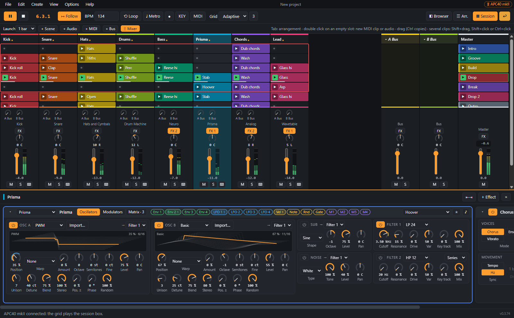
</p>
<p align="center"><sub>The session, playing the <i>Drop</i> scene. The red frame is what the APC40 mkII holds in its grid.</sub></p>


## Download

<p>
  <a href="https://github.com/davvoz/studiomio/releases/latest/download/studiomio-setup.exe"></a>
  <a href="https://github.com/davvoz/studiomio/releases/latest/download/studiomio.deb"></a>
  <a href="https://github.com/davvoz/studiomio/releases/latest/download/studiomio.AppImage">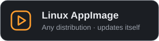</a>
</p>

| | Install | Good to know |
|---|---|---|
| **Windows** | Run the installer. No administrator rights, no questions. | It isn't code-signed, so the first time Windows asks: **More info → Run anyway**. It then updates itself. |
| **Debian, Ubuntu** | `sudo apt install ./studiomio.deb` | The package to prefer on Ubuntu 24.04 and later. |
| **Other Linux** | `chmod +x studiomio.AppImage`, then run it | It updates itself. On Ubuntu 24.04 and later it needs `--no-sandbox`. |

Every version with its notes is in the [releases](https://github.com/davvoz/studiomio/releases) and in the
[changelog](CHANGELOG.md).

**Your first minute:** *File › Load the demo project*, press <kbd>Space</kbd>, press <kbd>Tab</kbd> to switch
between arrangement and session, click a scene on the right. Then drop an audio file of yours on the timeline.


## What you can do with it

### Arrange

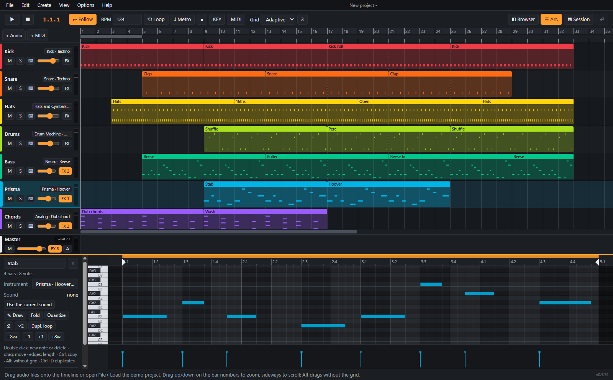

A canvas timeline with loop, adaptive or fixed grid, fades, time selection, consolidate and master automation.
Nested groups and send buses. The piano roll has velocities, fold, quantize, draw mode and a note preview.
Clips carry their own modulation curves on volume, pan and any parameter or macro, and the curves follow
the clip's loop.

### Warp

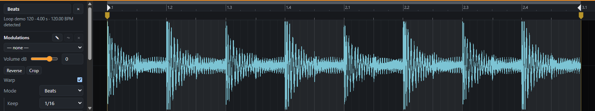

Audio follows the tempo. Transients and tempo are detected, warp markers are dragged by hand, and five
algorithms cover the rest: **Beats**, **Tones**, **Texture**, **Complex** and **Re-Pitch**. Transpose, reverse
and crop are per clip, and renders happen in parallel workers.

### Play live

- **Session** with quantized launch, from none to four bars, and a return to the arrangement per track.
- **MIDI recording** into the session with overdub, input quantization, latency compensation and recorded
  knob movements.
- **Controllers, plug and play:** Akai APC40 mkII and Novation Launchpad X, Mini MK3, Pro MK3 and MK2. Clip
  grid with the clips' colours, mixer, device knobs with their LED rings, transport.
- **Anything else** through a MIDI map and a computer-keyboard map. MIDI keyboards and the computer keyboard
  play the armed tracks.

### Shape with racks

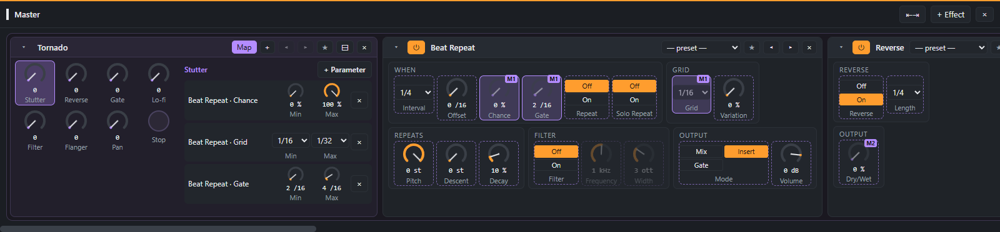

Group any devices behind eight macros, also racks inside racks. A macro can be a **knob**, a **toggle**, a
**button** held while you press it, or a **spring** that returns to its rest by itself. 31 racks come with the app.

### Modulate anything

**LFO** and **Envelope** are devices of the chain: click *⊕ Map*, click the knobs to move, also on other devices.
Up to eight targets each, adding up with the clips' curves and with each other.


## The sound

Nine instruments, 22 audio effects, two modulators and an arpeggiator, with more than 400 factory presets.

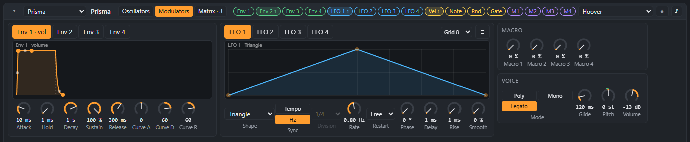

| Instrument | |
|---|---|
| **Prisma** | Wavetable synth with draggable modulation sources, a matrix, drawable LFOs, 13 filter types, imported tables and 111 presets |
| **Analog** | Two-oscillator subtractive: poly, mono or legato with glide, 303-style accent, unison up to 7 |
| **Wavetable** | Two oscillators on band-limited tables, sub, unison, two LFOs and a modulation envelope |
| **Neuro** | Mono reese and neuro basses: FM, wavefolder, formants, sub on a crossover, oversampled |
| **Sampler** | Classic, One-Shot and Slice, up to 32 zones, each with its own pitch, filter, envelopes and LFO |
| **Drum Machine** | 16 pads: synthesized, sampled, or holding a whole Kick, Snare or Hats and Cymbals |
| **Kick** · **Snare** | Drums built in layers, with the hit drawn by the same engine that plays it |
| **Hats and Cymbals** | Six pieces on the General MIDI notes, synthesized or sampled |

<table>
  <tr>
    <td width="50%">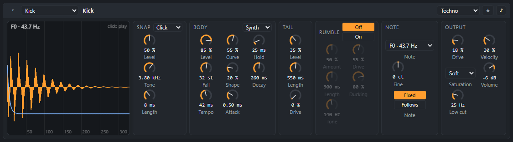</td>
    <td width="50%">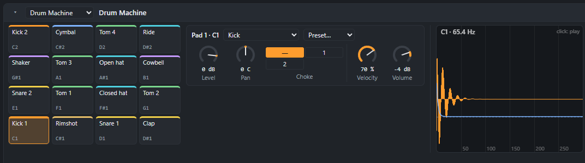</td>
  </tr>
</table>

Analog and Neuro also have a **step sequencer**: hold one note and it plays a locked, deterministic pattern
transposed onto it, with density, scale, accents and slide.

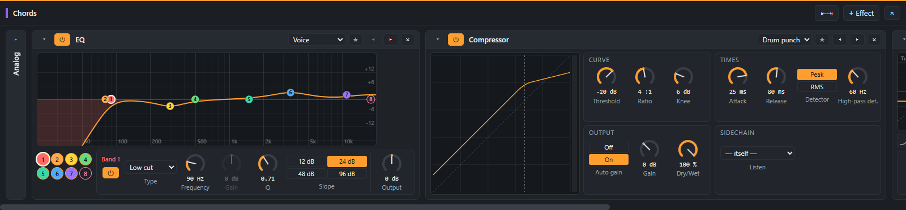

| Effects | |
|---|---|
| **Dynamics** | Compressor with sidechain · Noise Gate · Multiband · Transient · Limiter with lookahead and true peak |
| **Tone and drive** | EQ, eight bands · Auto Filter · Drive, six curves · Clipper · Redux |
| **Movement** | Auto Pan · Chorus · Phaser · Pitch Shifter · Spectral Resonator · Stereo |
| **Time and performance** | Delay · Reverb · Beat Repeat · Trance Gate · Tape Stop · Reverse |

The graphs aren't decoration: the EQ's curve uses the same maths as its sound, and the drums draw the hit they play.


## See it in a minute

Short tutorials made in the app, with its factory instruments.
[**Watch the whole playlist →**](https://www.youtube.com/playlist?list=PLXyZkj_dky5c)

<table>
  <tr>
    <td align="center" width="25%"><a href="https://www.youtube.com/shorts/8qigcKNuqm4"></a></td>
    <td align="center" width="25%"><a href="https://www.youtube.com/shorts/uOZxWOy7Fvg"></a></td>
    <td align="center" width="25%"><a href="https://www.youtube.com/shorts/COXqZ12rhGY"></a></td>
    <td align="center" width="25%"><a href="https://www.youtube.com/shorts/4d6gxcUzk7o"></a></td>
  </tr>
  <tr>
    <td align="center"><b>Four kinds of macro</b><br><sub>knob, button, toggle, spring</sub></td>
    <td align="center"><b>Acid, no notes drawn</b><br><sub>Analog's sequencer in a rack</sub></td>
    <td align="center"><b>Wobble routing</b><br><sub>modulations in Prisma</sub></td>
    <td align="center"><b>Rumble kick</b><br><sub>hard techno, from scratch</sub></td>
  </tr>
</table>


## Where it stands

studiomio is young (the first commit is from October 2026), moves fast and is still in its 0.x versions. It is
used to make and play full sets, but you should know what it isn't yet.

| | |
|---|---|
| ✅ **Solid** | Windows app, session and arrangement, the instruments and effects, saving with backup and crash recovery, APC40 mkII (played live on the hardware) |
| 🟡 **Less tested** | Linux packages. The Launchpads: written from their protocol, not verified on the hardware yet. If yours misbehaves, `studiomio.surfaces.report()` in the console says what it sends |
| ⬜ **Not there** | Audio recording from an input · VST and other plugins · tempo automation · recording onto the timeline · macOS package · a hosted web version |

Found something broken? Open an [issue](https://github.com/davvoz/studiomio/issues). The version number is at the
bottom right of the window.


## Quality

<p>
  <a href="https://sonarcloud.io/summary/new_code?id=davvoz_studiomio"></a>
  <a href="https://sonarcloud.io/component_measures?id=davvoz_studiomio&metric=coverage"></a>
  <a href="https://sonarcloud.io/summary/overall?id=davvoz_studiomio"></a>
  <a href="https://sonarcloud.io/summary/overall?id=davvoz_studiomio"></a>
  <a href="https://sonarcloud.io/summary/overall?id=davvoz_studiomio"></a>
  <a href="https://sonarcloud.io/component_measures?id=davvoz_studiomio&metric=ncloc"></a>
</p>

[SonarCloud](https://sonarcloud.io/summary/overall?id=davvoz_studiomio) analyses every push, and the badges above
are live. The tests (more than 1,900) don't cover everything equally, so here is where they are:

| Part of the code | Lines covered, November 2026 |
|---|---|
| Engine, DSP, instruments and effects, project model, editing, controllers | 98 % |
| Interface: views, editors, device panels | 76 % |
| Assembly: wiring of the app, menus, audio start-up | 60 % |

The warp is compared with a frozen reference implementation, and before a release is published its packaged
Windows app must start without errors on the build machine.


## Under the hood

<p align="center">
  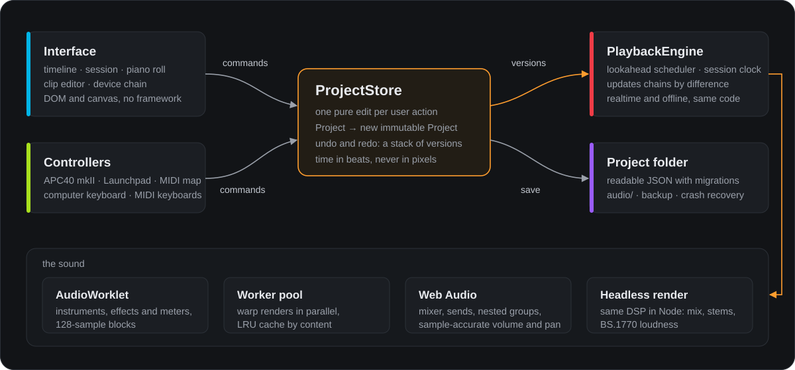
</p>

- **An immutable project.** Every edit is a pure function that returns a new `Project` sharing the untouched
  parts. Undo is a stack of versions, and the engine finds what changed by comparing references.
- **Two AudioWorklet processors**, one for instruments and one for effects. Each block is split at the exact
  sample of each note; parameters arrive as timed steps and ramps.
- **One engine, also without a browser.** `scripts/render-project.ts` computes the mix and the stems in Node with
  the same DSP, and measures the loudness (integrated, short-term, true peak).
- **Tables instead of switches.** Warp modes, clips, tracks and devices are registries: adding one means adding an
  entry, and the compiler points out what's missing.
- **No UI framework and one runtime dependency**, the updater.

<details>
<summary><b>The source tree</b></summary>

```
src/
  core/         typed ids, events, musical time (beats, BPM, time signature)
  model/        the immutable project: tracks (audio, MIDI, group, bus), clips, warp markers,
                notes, modulations, devices, racks and macros, scenes, launch quantization
  store/        ProjectStore (undo/redo as a stack of versions) and the edits, pure functions
                Project → Project, one per user action
  persistence/  project ⇄ JSON with version and migrations; the project folder on a Directory
                (File System Access, Node or in memory)
  engine/       playback: scheduler with lookahead, session (what each track plays and since when),
                scheduled modulations, effect chains updated by difference, LRU cache of the warp
                renders, offline export; all on audio-graph.ts (Web Audio or fake)
  devices/      instruments and effects: descriptions (parameters, sections, presets), DSP engines,
                factory racks; worklet/ the AudioWorklet processors; dsp/ the building blocks
                (PolyBLEP oscillators, SVF/TPT, ADSR, LFO, polyphony, oversampling, step sequencer)
  dsp/          warp engine, without DOM: stretch/ (beats, tones, texture, complex, repitch),
                analysis/ (onset, transients, tempo), codec/ (WAV, ZIP), wasm/ (bridge to Rust)
  workers/      typed RPC, worker pool, DspService
  browser/      the browser as data: sources, items, search
  control/      controllers via Web MIDI: APC40 mkII, Launchpad X / Mini MK3 / Pro MK3 / MK2
  ui/           timeline, session, piano roll, audio editor, modulations, device chain
                (controls generated from the parameters, graphic panels registered in displays.ts)
  app/          assembly: AudioContext, workers, engine, commands, opening and saving
electron/       main.ts: serves dist/ from app://studiomio with COOP/COEP, permissions, updates
crates/dsp/     phase vocoder in Rust → WebAssembly (SIMD)
scripts/        rendering without a browser (headless-render.ts, render-project.ts), BS.1770 loudness
tests/          one file per module; equivalence with WarpMio (tests/reference/)
```

</details>

<details>
<summary><b>The project folder</b></summary>

A project is a folder with `progetto.studiomio` (JSON: readable, versioned, diffable; `progetto.json` up to
0.3.57, still opened), `progetto.bak.json` (the previous save) and `audio/` (the original files, copied on
import). In the desktop app a double click on `progetto.studiomio`, or *Open in studiomio* in a folder's
right-click menu, opens it; on Windows the folder shows the app's icon (a hidden `desktop.ini` and
`studiomio.ico` inside it). Every change to the format comes with a migration.

</details>

<details>
<summary><b>Real-time audio</b></summary>

- **Worklets:** notes carry the context time; the DSP engines are registered by type in
  `devices/worklet/cores.ts`.
- **Parameters and modulations** are applied in blocks of 128 samples (`mod-timeline.ts`). Volume and pan are
  AudioParams, sample-accurate.
- **Transport:** effects and instruments that follow the bar (delay, gate, beat repeat, sequencer) get a
  beat ↔ context time anchor.
- **Meters:** peak and RMS written into a SharedArrayBuffer, which is why COOP/COEP are needed.
- **Warp:** audio clips are rendered in the workers and kept in an LRU cache by content. Session clips run on a
  continuous clock, which stays in phase with the timeline loop.
- **Safety:** an engine that produces an invalid sample or throws is silenced and restarted, without stopping
  the rest.

</details>

<details>
<summary><b>Warp performance</b></summary>

16 s of stereo in Complex mode, median of five runs on the development PC (`npm run bench`):

| | |
|---|---|
| TypeScript | 268 ms |
| WebAssembly (Rust, SIMD) | 324 ms |

The WebAssembly version is ready but off: on this load V8 is faster, and the real gain comes from rendering in
parallel workers. `VITE_DSP_WASM=1` turns it on.

</details>

### Build it

Node 22+, Rust with `wasm32-unknown-unknown`, and `wasm-pack`.

```sh
npm install
npm run wasm && npm run wasm:test   # once: the WebAssembly package isn't in the repository
npm run dev                         # http://localhost:5173, in Chrome or Edge
```

| Command | |
|---|---|
| `npm test` · `npm run typecheck` · `npm run lint` | tests (Vitest) · types · the SonarCloud rules, locally |
| `npm run coverage` | the coverage SonarCloud reads |
| `npm run bench` | speed of the warp and of Prisma |
| `npm run app` · `npm run dist` | the app in Electron · the Windows installer in `release/` |

The scripts in `scripts/` run with the app's modules: `node scripts/run.mjs scripts/<name>.ts …`.
A release is `release.bat`, or `npm version <patch|minor|major>` and `git push --follow-tags`: the tag builds,
checks and publishes it, with the changelog's entries as its notes.

### Add a device

1. Describe it (`DeviceType`: parameters, sections, presets) in `src/devices/instruments/<name>/` or
   `src/devices/effects/<name>/`, and register it in `registry.ts`.
2. Register its engine under the same name in `devices/worklet/cores.ts`: an `InstrumentCore` (`noteOn`,
   `noteOff`, `setParams`, `render`) or an `EffectCore` (`setParams`, `setTempo`, `process`).

The interface, saving, presets, undo, bypass, macro mapping and the messages to the audio thread come by
themselves. A graphic panel of its own goes in `ui/device/displays.ts`.


<p align="center">
  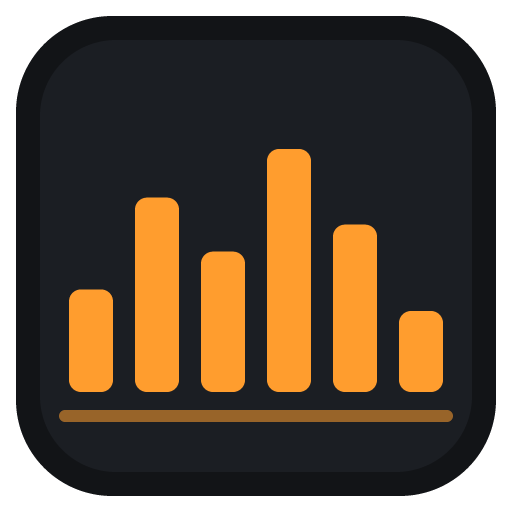<br>
  <b>studiomio</b> is released under the <a href="LICENSE">MIT license</a> · © 2026 David<br>
  <sub>Ableton and Live are trademarks of Ableton AG; Akai, APC40, Novation and Launchpad belong to their owners.</sub>
</p>
